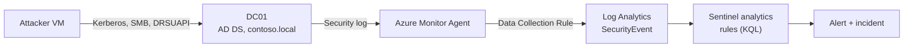

# sentinel-ad-attack-detection

Detection engineering for four classic Active Directory attacks on **Microsoft
Sentinel**. Each attack has a KQL detection, a Sentinel scheduled analytics rule in
YAML, a MITRE ATT&CK mapping, a lab simulation guide and tuning notes.

This is an independent lab on synthetic data. The domain is `contoso.local`. There
are no real systems, accounts or identifiers anywhere in it.

[](https://github.com/singh-adi5/sentinel-ad-attack-detection/actions/workflows/kql-validate.yml)

## Detections

| Attack | ATT&CK | Data source | Severity | Status |
|---|---|---|---|---|
| [Kerberoasting](detections/kerberoasting/README.md) | [T1558.003](https://attack.mitre.org/techniques/T1558/003/) | `SecurityEvent` 4769 | Medium | Logic validated |
| [DCSync](detections/dcsync/README.md) | [T1003.006](https://attack.mitre.org/techniques/T1003/006/) | `SecurityEvent` 4662, 4624 | High | Logic validated |
| [Password spraying](detections/password-spraying/README.md) | [T1110.003](https://attack.mitre.org/techniques/T1110/003/) | `SecurityEvent` 4771, 4625 | Medium | Logic validated |
| [Golden Ticket](detections/golden-ticket/README.md) | [T1558.001](https://attack.mitre.org/techniques/T1558/001/) | `SecurityEvent` 4768, 4769, 4770 | High | Logic validated |

**Status** is honest on purpose:

- **Logic validated** — the query parses against Microsoft's Kusto language service,
  reads only real `SecurityEvent` columns, and the rule passes the schema and
  ATT&CK checks in CI.
- **Fired in lab** — additionally seen raising an incident on simulated activity in
  a live workspace, with a screenshot in [`docs/evidence/`](docs/evidence/).

No detection is marked "Fired in lab" until that evidence exists. See
[PROGRESS.md](PROGRESS.md).

## Architecture



A Windows domain controller streams its Security event log through the Azure Monitor
Agent and a filtered Data Collection Rule into the `SecurityEvent` table. Four
scheduled analytics rules run the KQL and raise incidents with mapped entities. Full
version in [docs/ARCHITECTURE.md](docs/ARCHITECTURE.md).

## Repository layout

```
detections/<attack>/   query.kql, rule.yaml, README.md   (the detection content)
simulations/<attack>.md                                  (how to generate the telemetry)
deployment/            yaml_to_arm.py, dcr-securityevent.json, deploy-rules.md
docs/                  SETUP.md, ARCHITECTURE.md, DETECTIONS.md, evidence/
scripts/               validate_rules.py, kql_check.js, securityevent.schema
tests/                 test_tooling.py
.github/workflows/     kql-validate.yml
```

## Use it

Stand the lab up and reproduce the detections end to end:

1. **Build the lab** — [docs/SETUP.md](docs/SETUP.md): Azure network, domain
   controller, attacker host, Sentinel workspace, agent and collection rule.
2. **Deploy the rules** — [deployment/deploy-rules.md](deployment/deploy-rules.md):
   convert the YAML to an ARM template and import, or create by hand.
3. **Simulate and confirm** — the four guides in
   [simulations/](simulations/): generate the telemetry, confirm the rule fires,
   screenshot the incident into [docs/evidence/](docs/evidence/).

## Validate the content locally

No Azure needed for these:

```bash
pip install -r requirements-dev.txt
python scripts/validate_rules.py            # rule schema, ATT&CK ids, query parity
python -m unittest discover -s tests        # validator and converter tests
npm ci --ignore-scripts && npm run kql-check # KQL syntax and column analysis
```

CI runs all three on every push and pull request
([.github/workflows/kql-validate.yml](.github/workflows/kql-validate.yml)).

## Design notes

- **`SecurityEvent` only.** Everything runs on raw Windows events an Azure trial can
  collect, not on licensed Defender for Identity tables.
- **Columns are checked.** A query may only read a column listed in
  [`scripts/securityevent.schema`](scripts/securityevent.schema), verified against
  Microsoft's Kusto parser in CI. No invented fields.
- **Rules deploy disabled.** The converter sets `enabled: false` so each rule's
  allow-lists are tuned before it is switched on.
- **Honest about gaps.** Each detection README lists what it does **not** catch (AES
  roasting, silver tickets, low-and-slow sprays, DCSync by a real DC account) rather
  than implying full coverage.

## Standards

- Detections mapped to **MITRE ATT&CK** by technique, with mitigations referenced by id.
- Rule YAML follows Sentinel's `Scheduled` analytics-rule schema.
- Supply chain per **OWASP CI/CD Security** guidance: Actions pinned to commit SHAs,
  read-only workflow token, no persisted credentials, dependencies pinned and
  installed from lockfiles with install scripts disabled.
- Secrets hygiene and offensive-tool use covered in [SECURITY.md](SECURITY.md).

## Licence

[MIT](LICENSE).
