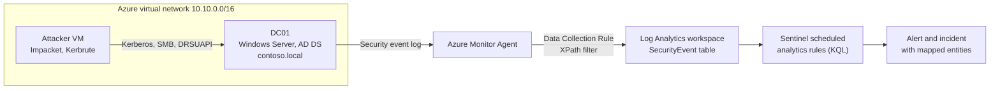

# Architecture

## Data flow

1. **The domain controller writes the event.** Advanced audit policy on DC01 decides
   which events exist at all. Without the right subcategories, nothing downstream
   can fire. See [SETUP.md](SETUP.md#5-turn-on-the-audit-policy).
2. **The Azure Monitor Agent reads the Security log.** AMA runs as a VM extension and
   authenticates with the VM's managed identity. There is no workspace key on the host.
3. **The Data Collection Rule filters and routes.** The DCR holds an XPath query that
   selects seven event IDs and sends them on the `Microsoft-SecurityEvent` stream.
   The sample is in [`deployment/dcr-securityevent.json`](../deployment/dcr-securityevent.json).
4. **Events land in `SecurityEvent`.** One row per event. Common fields are typed
   columns. The full event payload is also kept as XML in `EventData`.
5. **Scheduled analytics rules run the KQL.** Each rule runs on its `queryFrequency`
   over its `queryPeriod`. Any returned row raises an alert.
6. **Alerts become incidents.** Entity mappings attach the account, source address
   and host so an analyst can pivot without re-running the query.

## Why these seven event IDs

| Event ID | Meaning | Used by |
|---|---|---|
| 4624 | Successful logon | DCSync (source address lookup) |
| 4625 | Failed logon | Password spraying |
| 4662 | Operation performed on a directory object | DCSync |
| 4768 | Kerberos TGT requested | Golden Ticket |
| 4769 | Kerberos service ticket requested | Kerberoasting, Golden Ticket |
| 4770 | Kerberos service ticket renewed | Golden Ticket |
| 4771 | Kerberos pre-authentication failed | Password spraying |

The built-in "Common" collection tier in Sentinel does not include 4662. DCSync
detection needs either the "All Security Events" tier or a custom XPath filter.
This lab uses a custom filter: it collects what the rules read and nothing else,
which keeps ingestion inside the free allowance.

## Design decisions

**`SecurityEvent`, not `IdentityLogonEvents`.** The Defender for Identity tables
would make two of these detections easier, but they need a licence a trial
subscription does not include. Everything here runs on raw Windows events.

**Kerberos fields are read two ways.** For events 4768 to 4771 the queries use the
typed column (`TicketEncryptionType`, `ServiceName`, `Status`) when it is populated
and fall back to extracting the same field from `EventData`. Microsoft's own
Kerberoasting rule template parses `EventData` for these events, so the fallback is
there for workspaces where the typed columns arrive empty.

**Account and address are normalised before any comparison.** Event 4768 records
`alice`, event 4769 records `alice@CONTOSO.LOCAL`, and both record IPv4 addresses
as `::ffff:10.10.1.5`. Each query lower-cases the name, drops the realm and strips
the IPv6 prefix. Skipping this step makes the Golden Ticket join match nothing.

**Tunable values are `let` statements at the top of each query.** Thresholds and
allow-lists can be changed without reading the rest of the query.

**Rules deploy disabled.** The converter in `deployment/` creates each rule with
`enabled: false`. The DCSync rule in particular needs the domain controller list
set correctly before it is switched on.

## Trust boundaries

| Boundary | Control |
|---|---|
| Internet to lab network | NSG allows RDP and SSH from one operator address only |
| Host to workspace | Managed identity, no shared key on disk |
| Repository to Azure | No identifiers or credentials in the repository. Deployment takes the workspace name as a parameter |
| Contributor to main branch | CI validates every rule. The workflow token is read-only |

## Limits of this design

- One domain controller. The Golden Ticket rule assumes Kerberos events from every
  DC are collected. In a multi-DC domain, a missing DC produces false positives.
- No endpoint telemetry. Process creation on the attacker's host is not visible.
  These are directory-side detections only.
- Scheduled rules are not real time. Worst-case detection delay is the rule's
  `queryFrequency` plus ingestion latency of a few minutes.
